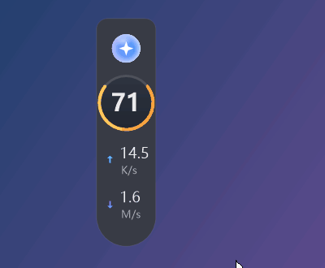
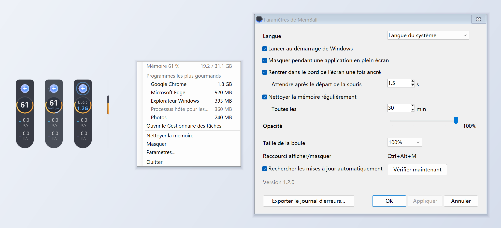

# MemBall

[English](README.md) | [简体中文](README.zh-CN.md) | **Français**

Une boule flottante pour Windows : elle affiche la mémoire utilisée et le débit réseau en direct au bord de l'écran, et nettoie la mémoire en un clic.

MemBall a été créé avec [Claude Code](https://claude.com/claude-code) : le code, l'installateur et les traductions ont été écrits par Claude, et tout l'historique des commits est public.

## Fonctionnalités

- **Anneau de mémoire** : mémoire utilisée en pourcentage, en direct ; bleu sous 60 %, orange de 60 à 80 %, rouge au-delà de 80 %
- **Débit réseau** : envoi et réception
- **Nettoyage en un clic** : cliquez sur la boule pour réduire les jeux de travail des programmes ; elle indique la quantité de mémoire libérée
- **Nettoyage programmé** : en option, toutes les 5 à 720 minutes ; un nettoyage prévu pendant un jeu ou une vidéo en plein écran attend la fin
- **Ancrage au bord** : déposez-la près du bord gauche ou droit de l'écran et elle s'y accroche ; quand la souris s'éloigne, elle se rentre en une fine barre qui affiche toujours la mémoire utilisée, et ressort quand la souris touche le bord
- **Masquée en plein écran** : elle s'efface quand un jeu, une vidéo ou une autre application en plein écran est au premier plan
- **Menu du clic droit** : mémoire en Go, les cinq programmes qui utilisent le plus de mémoire (que vous pouvez arrêter depuis le menu), Gestionnaire des tâches
- **Icône de la zone de notification** : affiche la mémoire utilisée ; double-cliquez dessus pour masquer ou afficher la boule
- **Paramètres** : langue (English / 简体中文 / Français), lancement au démarrage de Windows, masquage en plein écran, rentrée dans le bord, nettoyage programmé, opacité, recherche automatique des mises à jour
- **Mises à jour** : vous prévient quand une nouvelle version sort et se met à jour en un clic après confirmation

## Téléchargement et installation

Téléchargez la dernière version depuis la page [Releases](https://github.com/yydsyin/memball/releases) et choisissez :

| Fichier | Description |
|---|---|
| `MemBall-Setup.exe` | Installation : installe dans `C:\Program Files\MemBall` avec un raccourci dans le menu Démarrer ; désinstallation depuis Paramètres → Applications |
| `MemBall.exe` | Version portable : placez-la où vous voulez et double-cliquez dessus |

Configuration requise : Windows 10 ou 11 (le .NET Framework 4.8 nécessaire fait déjà partie de Windows).

> Le programme n'est pas signé numériquement : au premier lancement, Windows SmartScreen peut afficher « Windows a protégé votre ordinateur ». Cliquez sur « Informations complémentaires », puis sur « Exécuter quand même ».

Analyses VirusTotal : [MemBall.exe](https://www.virustotal.com/gui/file/417c48f418825627855a00d42354a7e8e672ed041f618b760f8902cd085c0842), [MemBall-Setup.exe](https://www.virustotal.com/gui/file/8177aa6044c847d22a328a1dcb1abf04f17d3b56ece12b8fe8968a7df7555905). Les principaux moteurs, comme Microsoft Defender, Kaspersky, ESET, BitDefender et Avast, ne signalent rien. Quelques moteurs à apprentissage automatique le jugent suspect, car c'est un programme récent, sans signature numérique, qui arrête des processus, réduit la mémoire et crée une tâche d'ouverture de session.

## Historique des versions

Les changements de chaque version sont décrits sur la page [Releases](https://github.com/yydsyin/memball/releases). La version installée comme la version portable vous préviennent quand une nouvelle version sort, et la fenêtre de mise à jour affiche aussi ces notes.

## Utilisation

- **Clic** sur la boule : nettoyer la mémoire
- **Glisser** : la déplacer ; déposez-la près du bord gauche ou droit de l'écran pour l'ancrer
- **Clic droit** : détails de la mémoire, programmes les plus gourmands, nettoyer, masquer, paramètres, quitter
- **Raccourci** `Ctrl+Alt+M` (`Ctrl+Alt+Shift+M` si un autre programme l'utilise déjà) : afficher / masquer
- **Icône de la zone de notification** : double-clic pour afficher / masquer, clic droit pour quitter
- **Lancement au démarrage** : activé par défaut avec l'installation ; activez-le ou désactivez-le à tout moment dans les Paramètres

## Pourquoi il faut les droits administrateur

Pour nettoyer la mémoire, MemBall demande à Windows de réduire d'un coup les jeux de travail de tous les programmes, ce qui exige les droits administrateur. Sans eux, il ne peut réduire, un par un, que les programmes accessibles à l'utilisateur actuel, ce qui libère moins de mémoire. Le lancement au démarrage passe par une tâche planifiée avec les privilèges les plus élevés, donc aucune invite UAC n'apparaît à l'ouverture de session.

## Fonctionnement du nettoyage et effets secondaires

« Nettoyer » demande à Windows de sortir de la mémoire physique les pages que les programmes n'utilisent pas en ce moment (réduction de leurs jeux de travail), ce qui libère de la mémoire. Rien n'est perdu : quand un programme a de nouveau besoin de ces données, Windows les relit depuis le disque ou la mémoire compressée.

Par conséquent :

- Un programme nettoyé **peut ralentir un instant quand vous y revenez**
- **Un PC qui a beaucoup de mémoire libre a rarement besoin d'être nettoyé** : Windows gère très bien la mémoire tout seul. Le nettoyage est surtout utile quand la mémoire manque et qu'il faut de la place tout de suite
- Quand vous arrêtez un programme depuis le menu du clic droit, **ses modifications non enregistrées sont perdues** : enregistrez d'abord

## Confidentialité

MemBall ne collecte et n'envoie aucune donnée. Son seul accès réseau est la recherche de mises à jour : au plus une fois par jour, il lit le dernier numéro de version sur l'API publique de GitHub (désactivable dans les Paramètres). Les paramètres et les journaux d'erreurs restent sur votre PC, dans `%LOCALAPPDATA%\MemBall`.

## Désinstallation

- Version installée : Paramètres → Applications → MemBall → Désinstaller ; vous pouvez aussi supprimer vos paramètres et journaux
- Version portable : désactivez « Lancer au démarrage de Windows » dans les Paramètres, quittez MemBall, puis supprimez `MemBall.exe`

## Compiler soi-même

Vous n'êtes pas obligé de faire confiance à l'exe publié : vous pouvez compiler MemBall vous-même. Windows contient déjà le compilateur C# nécessaire (.NET Framework 4.x), il n'y a donc rien à installer.

1. Téléchargez le code source (Code → Download ZIP) ou clonez le dépôt
2. Double-cliquez sur `build.bat`
3. `MemBall.exe` (portable) et `MemBall-Setup.exe` (installation) apparaissent à côté

Votre version fonctionnera comme celle publiée, mais son SHA-256 sera différent, car le compilateur marque chaque compilation différemment.

## Signaler un problème

Ouvrez une [issue](https://github.com/yydsyin/memball/issues). En cas d'anomalie, joignez le rapport de diagnostic obtenu par Paramètres → « Exporter le journal d'erreurs… » ; il ne contient ni votre nom d'utilisateur ni le nom de votre ordinateur.

## Licence

[MIT](LICENSE) : utilisation, modification et partage libres, sans aucune garantie.
