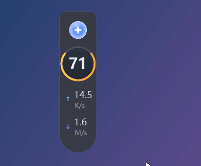
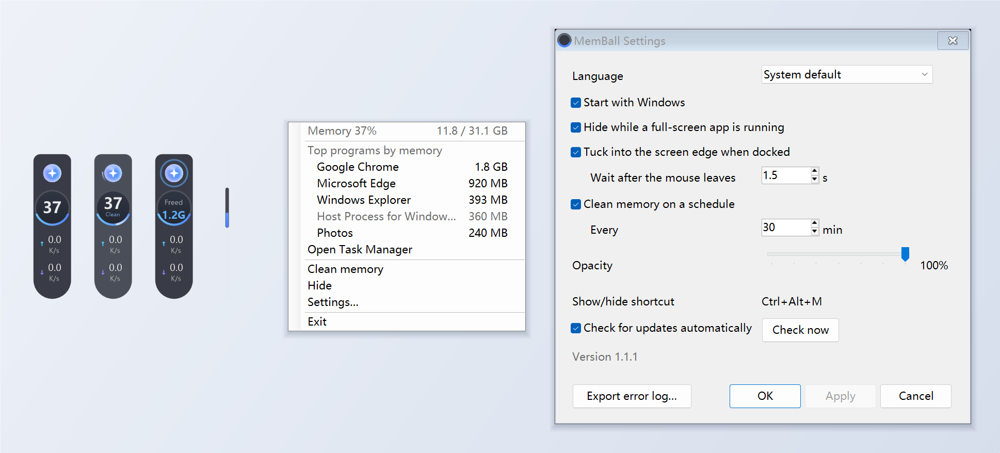

# MemBall

**English** | [简体中文](README.zh-CN.md) | [Français](README.fr.md)

A floating memory ball for Windows: it shows memory use and live network speed at the edge of your screen, and cleans memory in one click.

MemBall was built with [Claude Code](https://claude.com/claude-code): the code, the installer and the translations were written by Claude, and the full commit history is public.

## Features

- **Memory ring**: live memory use in percent; blue below 60%, orange from 60 to 80%, red above 80%
- **Network speed**: upload and download
- **One-click clean**: click the ball to trim the working sets of running programs; it shows how much memory was freed
- **Scheduled cleaning**: optionally clean every 5 to 720 minutes; a clean that falls due during a full-screen game or video waits until it ends
- **Edge docking**: drop it near the left or right screen edge and it snaps there; when the mouse leaves, it tucks into a thin strip that still shows memory use, and slides back out when the mouse touches the edge
- **Hides for full screen**: fades out while a game, video or other full-screen app is in front
- **Right-click menu**: memory in GB, the five programs using the most memory (which you can end from there), Task Manager
- **Tray icon**: shows memory use; double-click it to hide or show the ball
- **Settings**: language (English / 简体中文 / Français), start with Windows, hide for full screen, edge tucking, scheduled cleaning, opacity, automatic update check
- **Updates**: tells you when a new version is out and updates in one click after you confirm

## Download and install

Download the latest version from the [Releases](https://github.com/yydsyin/memball/releases) page and pick one:

| File | What it is |
|---|---|
| `MemBall-Setup.exe` | Installer: installs to `C:\Program Files\MemBall` with a Start menu shortcut; uninstall it from Settings → Apps |
| `MemBall.exe` | Portable: put it anywhere and double-click it |

Requirements: Windows 10 or 11 (the .NET Framework 4.8 it needs is already part of Windows).

> The program is not code-signed, so on first run Windows SmartScreen may say "Windows protected your PC". Click "More info", then "Run anyway".

VirusTotal scans: [MemBall.exe](https://www.virustotal.com/gui/file/278f28444bc3000d3a429f89d4a4584a1c5280f3c272346a25a852a8308b4190), [MemBall-Setup.exe](https://www.virustotal.com/gui/file/b66646d8d722d2e85ebc06b2edffe955bcf1e3fd69f834aeeeaf8a38fb9ddaea). Kaspersky, ESET, BitDefender, Avast and most other major engines report nothing. Microsoft Defender currently flags the installer (not MemBall.exe) as `Trojan:Win32/Wacatac.B!ml`, a machine-learning verdict, and a few other machine-learning engines flag both files. They do so because MemBall is a new program without a digital signature that ends processes, trims memory and creates a logon task. The source is public, so you can check what it does or build it yourself (see below).

> **Smart App Control:** if Smart App Control is turned on in Windows 11, MemBall cannot run for now, and neither can a copy you build yourself. MemBall is not digitally signed yet, and Smart App Control blocks unsigned apps without offering a way to allow them. Other PCs are not affected.

## Changelog

What changed in each version is listed on the [Releases](https://github.com/yydsyin/memball/releases) page. Both the installer and the portable version tell you when a new version is out, and the update window shows these notes too.

## How to use

- **Click** the ball: clean memory
- **Drag** it: move it; drop it near the left or right screen edge to dock it
- **Right-click** it: memory details, top programs, clean, hide, settings, exit
- **Shortcut** `Ctrl+Alt+M` (`Ctrl+Alt+Shift+M` if another program already uses it): show / hide
- **Tray icon**: double-click to show / hide, right-click to exit
- **Start with Windows**: on by default with the installer; turn it on or off any time in Settings

## Why it needs administrator rights

To clean memory, MemBall asks Windows to trim the working sets of all programs at once, which requires administrator rights. Without them it can only trim, one by one, the programs the current user may access, which frees less. Starting with Windows uses a scheduled task with highest privileges, so no UAC prompt appears at logon.

## How cleaning works, and its side effects

"Cleaning" asks Windows to move memory pages that programs are not using right now out of physical memory (trimming their working sets), which frees memory. Nothing is lost: when a program needs that data again, Windows reads it back from disk or from compressed memory.

So:

- A trimmed program **may pause briefly when you switch back to it**
- **A PC with plenty of free memory rarely needs cleaning**: Windows manages memory well on its own. Cleaning helps most when memory is tight and you need room right away
- When you end a program from the right-click menu, **its unsaved work is lost**, so save first

## Privacy

MemBall collects and sends no data. Its only network access is the update check: at most once a day it reads the latest version number from GitHub's public API (you can turn this off in Settings). Settings and error logs stay on your PC in `%LOCALAPPDATA%\MemBall`.

## Uninstall

- Installer version: Settings → Apps → MemBall → Uninstall; you can choose to delete your settings and logs as well
- Portable version: turn off "Start with Windows" in Settings, exit MemBall, then delete `MemBall.exe`

## Build from source

You don't have to trust the published exe: you can build MemBall yourself. Windows already includes the C# compiler it needs (.NET Framework 4.x), so there is nothing to install.

1. Download the source (Code → Download ZIP) or clone the repository
2. Double-click `build.bat`
3. `MemBall.exe` (portable) and `MemBall-Setup.exe` (installer) appear next to it

Your build will work the same as the published one, but its SHA-256 will differ, because the compiler stamps every build differently.

## Reporting a problem

Please open an [issue](https://github.com/yydsyin/memball/issues). If something went wrong, attach the diagnostics report from Settings → "Export error log…"; it does not contain your user name or computer name.

## Code signing policy

Signing is being set up: the releases are not signed yet.

Free code signing provided by [SignPath.io](https://signpath.io), certificate by [SignPath Foundation](https://signpath.org).

- Committers and reviewers: [yydsyin](https://github.com/yydsyin)
- Approvers: [yydsyin](https://github.com/yydsyin)

Privacy: MemBall does not transfer any information to other networked systems, except for the daily update check against GitHub's public API, which you can turn off in Settings.

## License

[MIT](LICENSE): free to use, change and share, provided without any warranty.
