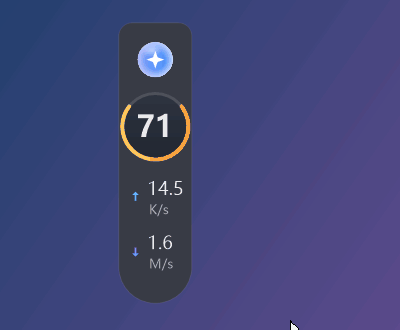
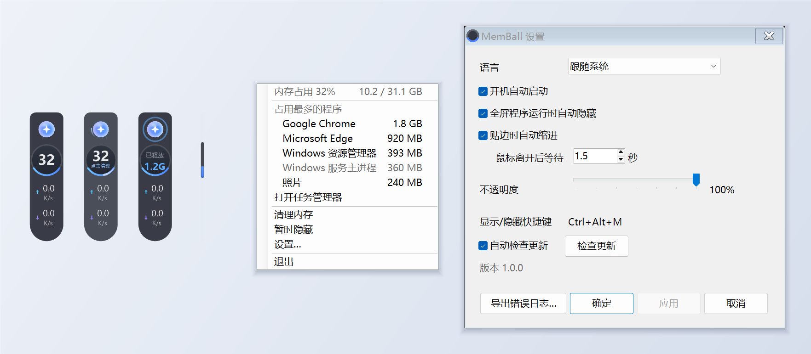

# MemBall

[English](README.md) | **简体中文** | [Français](README.fr.md)

Windows 内存悬浮球：在屏幕边上显示内存占用和实时网速，单击一下就能清理内存。

MemBall 是用 [Claude Code](https://claude.com/claude-code) 做的：代码、安装程序和翻译都由 Claude 编写，完整的提交历史全部公开。

## 功能

- **内存圆环**：实时显示内存占用百分比；低于 60% 为蓝色，60–80% 为橙色，80% 以上为红色
- **网速**：上传和下载速度
- **一键清理**：单击悬浮球即可修剪各程序的工作集，并显示释放了多少内存
- **定时清理**：可选每隔 5 到 720 分钟自动清理一次；到点时如果正在全屏玩游戏或看视频，会等结束后再清理
- **贴边缩进**：拖到屏幕左右边缘附近松手会自动吸附；鼠标离开后缩成一条仍显示内存占用的细条，鼠标碰到边缘时再滑出来
- **全屏自动隐藏**：玩游戏、看视频等全屏程序在前台时自动淡出
- **右键菜单**：内存用量（GB）、占用内存最多的 5 个程序（可在菜单中直接结束）、任务管理器
- **托盘图标**：显示内存占用；双击可隐藏或显示悬浮球
- **设置**：语言（English / 简体中文 / Français）、开机自动启动、全屏时自动隐藏、贴边缩进、定时清理、不透明度、自动检查更新
- **更新**：有新版本时提醒你，确认后一键更新

## 下载与安装

在 [Releases](https://github.com/yydsyin/memball/releases) 页面下载最新版本，二选一：

| 文件 | 说明 |
|---|---|
| `MemBall-Setup.exe` | 安装版：安装到 `C:\Program Files\MemBall`，带开始菜单快捷方式；可在“设置 → 应用”中卸载 |
| `MemBall.exe` | 免安装版：放在任意位置，双击运行 |

系统要求：Windows 10 或 11（所需的 .NET Framework 4.8 已是 Windows 自带组件）。

> 程序没有数字签名，首次运行时 Windows SmartScreen 可能提示“Windows 已保护你的电脑”。点击“更多信息”，再点“仍要运行”即可。

VirusTotal 扫描结果：[MemBall.exe](https://www.virustotal.com/gui/file/278f28444bc3000d3a429f89d4a4584a1c5280f3c272346a25a852a8308b4190)、[MemBall-Setup.exe](https://www.virustotal.com/gui/file/b66646d8d722d2e85ebc06b2edffe955bcf1e3fd69f834aeeeaf8a38fb9ddaea)。卡巴斯基、ESET、BitDefender、Avast 等大多数主流引擎均未报毒。Microsoft Defender 目前会把安装包（不包括 MemBall.exe）报为 `Trojan:Win32/Wacatac.B!ml`，这是机器学习给出的判断；另有少数机器学习引擎会把两个文件都标为可疑。原因是 MemBall 是一个新的、没有数字签名的程序，而且会结束进程、修剪内存、创建开机计划任务。源码是公开的，你可以检查它做了什么，或者自己编译（见下文）。

> **智能应用控制：** 如果你的 Windows 11 开启了“智能应用控制”，MemBall 目前无法运行，自己编译的版本也一样。因为 MemBall 还没有数字签名，而智能应用控制会阻止所有未签名的应用，并且不提供手动允许的选项。其他电脑不受影响。

## 更新日志

每个版本改了什么，见 [Releases](https://github.com/yydsyin/memball/releases) 页面。安装版和免安装版都会在有新版本时提醒你，更新窗口里也会显示这些说明。

## 使用方法

- **单击**悬浮球：清理内存
- **拖动**：移动位置；在屏幕左右边缘附近松手即可吸附
- **右键**：内存详情、占用最多的程序、清理、暂时隐藏、设置、退出
- **快捷键** `Ctrl+Alt+M`（如果已被其他程序占用，则为 `Ctrl+Alt+Shift+M`）：显示 / 隐藏
- **托盘图标**：双击显示 / 隐藏，右键退出
- **开机自启**：安装版默认开启，也可以随时在“设置”中开关

## 为什么需要管理员权限

清理内存时，MemBall 会请 Windows 一次性修剪所有程序的工作集，这需要管理员权限。没有管理员权限时，只能逐个修剪当前用户有权访问的程序，释放的内存会更少。开机自启是通过“最高权限”的计划任务实现的，所以登录时不会弹出 UAC 提示。

## 清理内存的原理和副作用

“清理”是请 Windows 把各程序当前没在使用的内存页移出物理内存（修剪工作集），从而腾出可用内存。数据并没有丢失：程序再次需要时，Windows 会从磁盘或内存压缩区把它读回来。

因此：

- 被修剪的程序**在你切换回去时可能会短暂卡顿**
- **内存充足的电脑平时很少需要清理**：Windows 自己就能很好地管理内存。清理最适合内存紧张、需要马上腾出空间的时候
- 通过右键菜单结束程序时，**该程序中未保存的内容会丢失**，请先保存

## 隐私

MemBall 不收集、也不发送任何数据。唯一的联网行为是检查更新：每天最多一次，从 GitHub 的公开接口读取最新版本号（可在设置中关闭）。设置和错误日志都保存在你电脑上的 `%LOCALAPPDATA%\MemBall`。

## 卸载

- 安装版：“设置 → 应用 → MemBall → 卸载”，可以选择是否同时删除设置和日志
- 免安装版：在设置中关闭“开机自动启动”，退出 MemBall，然后删除 `MemBall.exe`

## 自己编译

不想信任发布的 exe，也可以自己编译。Windows 已经自带所需的 C# 编译器（.NET Framework 4.x），不用安装任何东西。

1. 下载源码（Code → Download ZIP），或克隆仓库
2. 双击 `build.bat`
3. 旁边会生成 `MemBall.exe`（免安装版）和 `MemBall-Setup.exe`（安装版）

自己编译的版本和发布的版本功能完全一样，但 SHA-256 会不同，因为编译器每次编译都会写入不同的标记。

## 反馈问题

请提交 [Issue](https://github.com/yydsyin/memball/issues)。如果遇到异常，请附上在“设置 → 导出错误日志…”中导出的诊断报告；报告中不包含你的用户名和电脑名。

## 许可

[MIT](LICENSE)：可免费使用、修改和分享，不提供任何担保。
